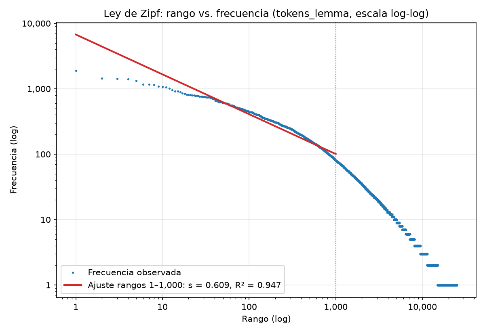
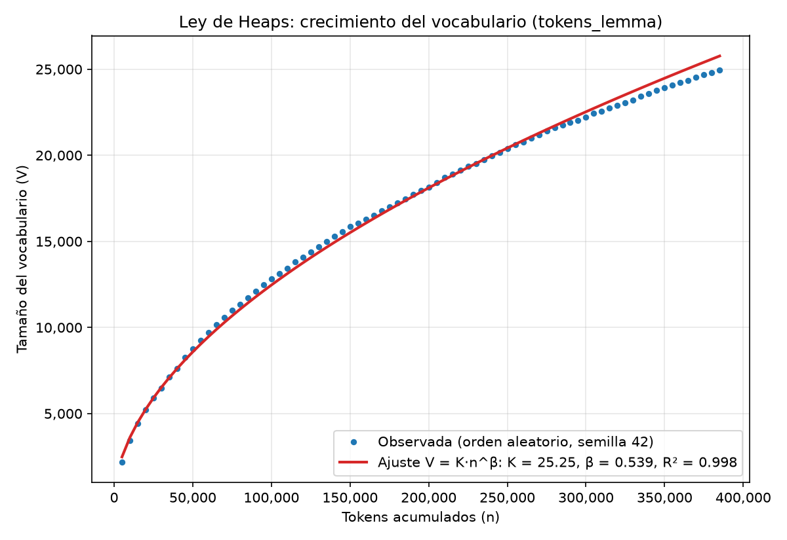
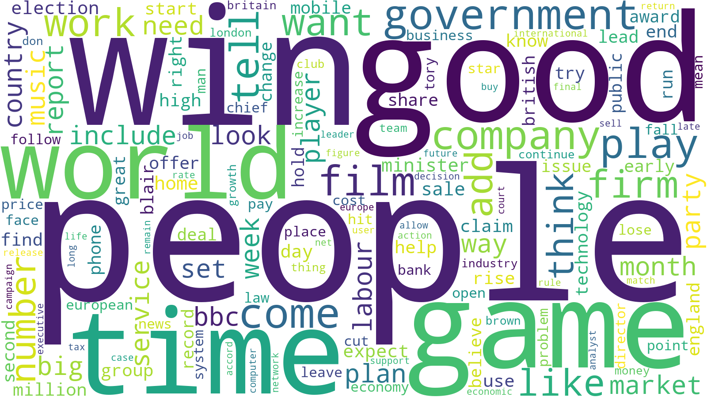
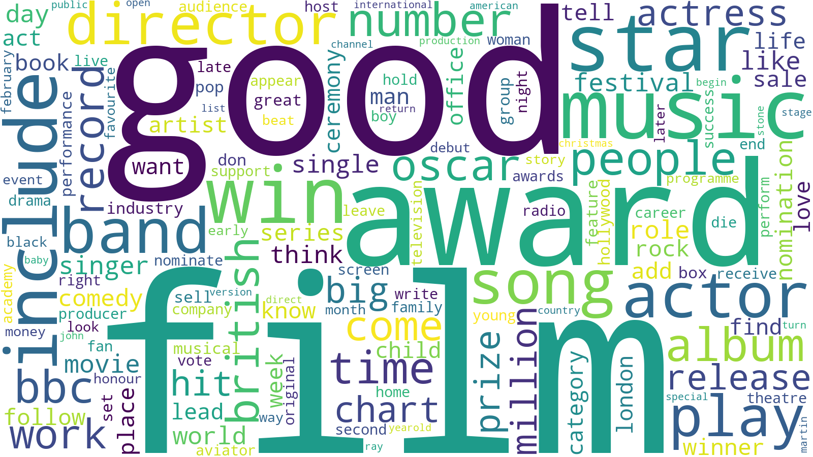
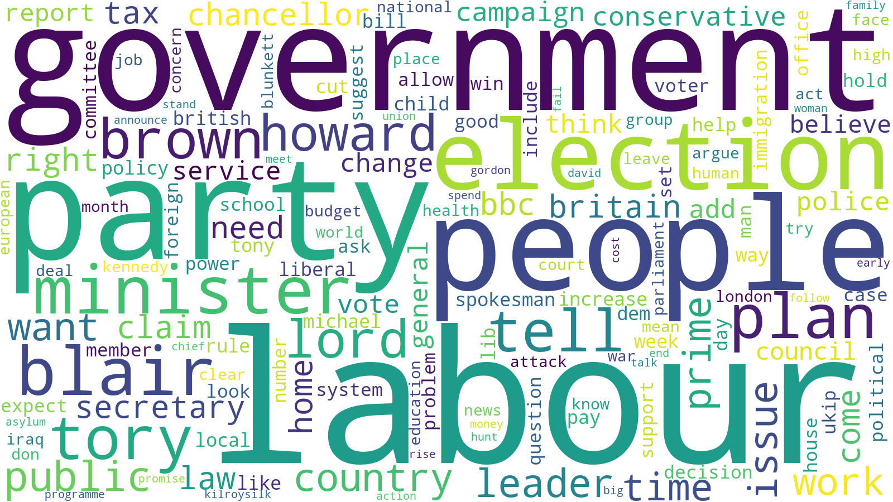
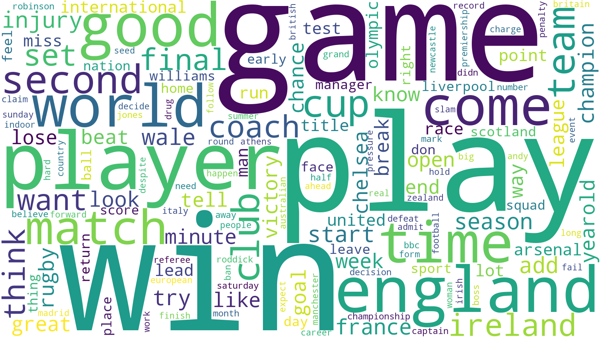
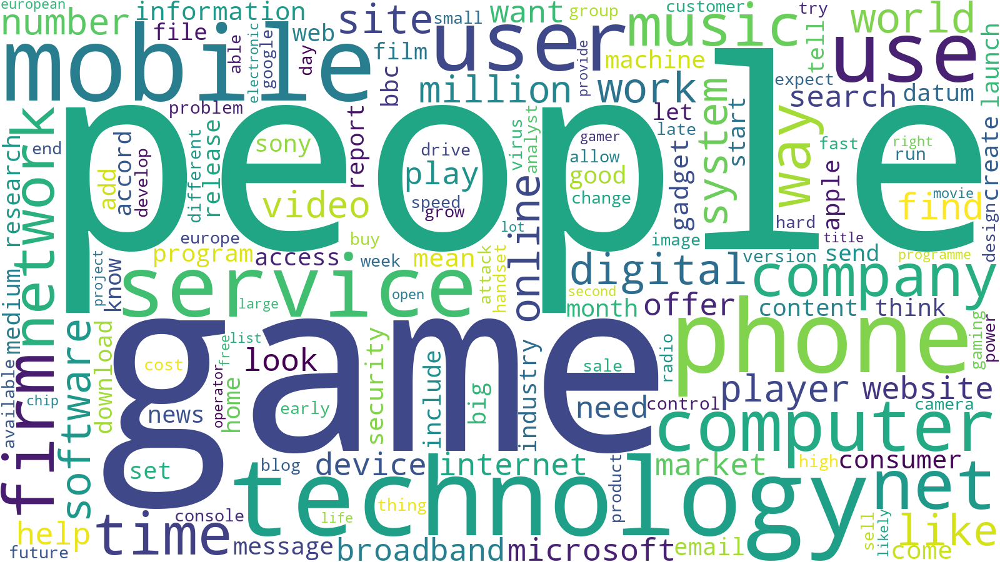

# EDA del corpus limpio (modo corpus)

Entrada: `data/processed/corpus_clean.csv` (2,126 documentos), columna `tokens_lemma`.

## Vocabulario

- Tamaño del corpus (N): **385,689** tokens (media 181.42 por documento).
- Tamaño del vocabulario (V): **24,971** tipos.
- Hapax legomena: **9,980** (39.97% del vocabulario; 2.59% de los tokens).

Top 30 global (completo y top 15 por categoría en `vocabulario_top.csv`):

| Rango | Término | Frecuencia | % de tokens |
|---:|---|---:|---:|
| 1 | people | 1,894 | 0.49% |
| 2 | win | 1,448 | 0.38% |
| 3 | good | 1,432 | 0.37% |
| 4 | game | 1,402 | 0.36% |
| 5 | time | 1,330 | 0.34% |
| 6 | world | 1,171 | 0.30% |
| 7 | government | 1,163 | 0.30% |
| 8 | come | 1,156 | 0.30% |
| 9 | play | 1,087 | 0.28% |
| 10 | company | 1,067 | 0.28% |
| 11 | film | 1,061 | 0.28% |
| 12 | tell | 1,014 | 0.26% |
| 13 | work | 952 | 0.25% |
| 14 | want | 921 | 0.24% |
| 15 | firm | 912 | 0.24% |
| 16 | add | 896 | 0.23% |
| 17 | like | 852 | 0.22% |
| 18 | think | 839 | 0.22% |
| 19 | number | 825 | 0.21% |
| 20 | include | 809 | 0.21% |
| 21 | country | 803 | 0.21% |
| 22 | market | 800 | 0.21% |
| 23 | way | 792 | 0.21% |
| 24 | month | 788 | 0.20% |
| 25 | set | 781 | 0.20% |
| 26 | service | 769 | 0.20% |
| 27 | plan | 766 | 0.20% |
| 28 | labour | 763 | 0.20% |
| 29 | player | 760 | 0.20% |
| 30 | need | 750 | 0.19% |

### Vocabulario por categoría

| Categoría | Tokens | Vocabulario | Términos exclusivos | Top 10 exclusivos (frecuencia) |
|---|---:|---:|---:|---|
| business | 81,183 | 9,056 | 3,217 | yukos (195), lse (79), gazprom (73), fiat (70), boerse (67), worldcom (65), yugansk (59), ebber (58), rosneft (58), boeing (44) |
| entertainment | 59,571 | 9,420 | 3,493 | actress (154), festival (143), aviator (88), foxx (55), rapper (47), drake (45), scorsese (42), swank (41), eastwood (39), staunton (38) |
| politics | 84,689 | 8,513 | 2,493 | tory (440), lib (171), ukip (128), blunkett (105), kilroysilk (105), asylum (96), torie (46), detention (38), prescott (38), goldsmith (37) |
| sport | 77,122 | 8,660 | 3,426 | roddick (120), referee (90), mourinho (71), nadal (64), kenteris (63), iaaf (62), federer (56), gara (56), wenger (56), henman (54) |
| tech | 83,124 | 9,331 | 3,331 | portable (79), spam (77), browser (57), multimedia (55), server (53), domain (49), psp (47), halo (43), wifi (43), windows (39) |

### Top 15 por categoría

| Categoría | Términos |
|---|---|
| business | company (622), firm (536), market (515), rise (439), sale (410), bank (407), price (386), share (382), economy (366), growth (362), government (352), country (317), economic (312), month (306), fall (302) |
| entertainment | film (903), good (564), award (424), music (423), star (386), win (371), include (310), actor (235), band (229), song (226), director (214), play (210), people (204), number (200), album (198) |
| politics | labour (728), government (725), party (674), people (607), election (588), minister (539), blair (537), plan (445), tory (440), tell (397), brown (356), lord (313), howard (309), public (304), issue (281) |
| sport | win (809), game (606), play (587), player (468), england (455), good (403), world (381), time (367), come (336), match (329), second (305), team (301), cup (291), club (288), ireland (263) |
| tech | people (828), game (691), technology (545), mobile (514), phone (485), service (413), user (393), use (392), computer (347), net (329), firm (321), company (318), time (312), music (310), way (306) |

## Zipf

Ajuste `log f = log C − s·log r` con `numpy.polyfit` (log10) sobre los rangos 1 a 1,000:

- **s = 0.6088**, C = 6,751.38, **R² = 0.9469**.
- Rango esperado para validación: 0.6 a 1.5 → dentro del rango.

## Heaps

Documentos en orden aleatorio (semilla 42), registro cada 5,000 tokens (77 puntos); ajuste `V = K·n^β` en log-log:

- **K = 25.25**, **β = 0.5387**, **R² = 0.9976**.
- Rango esperado para validación: 0.3 a 0.8 → dentro; rango típico en inglés 0.4 a 0.7 → dentro.

## Wordclouds

Generadas con frecuencias de `tokens_lemma` (`generate_from_frequencies`, `random_state=42`, `max_words=150`).

- [Global](figuras/wordcloud_global.png)
- [business](figuras/wordcloud_business.png)
- [entertainment](figuras/wordcloud_entertainment.png)
- [politics](figuras/wordcloud_politics.png)
- [sport](figuras/wordcloud_sport.png)
- [tech](figuras/wordcloud_tech.png)

## Lema vs. stem

| Representación | Tokens | Vocabulario |
|---|---:|---:|
| `tokens_lemma` | 385,689 | 24,971 |
| `tokens_stem` | 394,426 | 21,127 |

El stemming reduce el vocabulario en 3,844 tipos (15.39%) respecto a la lematización (más agresivo al colapsar variantes), a costa de formas menos legibles y de fusionar palabras de significado distinto.

## Conclusiones para la indexación

- El índice tendrá 24,971 términos (lemas) sobre 385,689 tokens; 39.97% del vocabulario son hapax, que casi no discriminan entre documentos pero inflan el índice: considerar `min_df=2` si se busca compactar.
- Zipf con s = 0.609 (R² = 0.947): pocos términos concentran gran parte de los tokens; las palabras más frecuentes aportan poco peso discriminativo y justifican ponderación por IDF (TF-IDF/BM25) o una lista de stopwords adicional.
- Heaps con β = 0.539 (K = 25.25): el vocabulario sigue creciendo con el corpus, así que consultas con términos no vistos serán frecuentes; el crecimiento es sublineal, como se espera en texto.
- Lema vs. stem: el stem comprime el vocabulario 15.39% (21,127 vs. 24,971), lo que favorece la cobertura (recall) al unir variantes; el lema conserva más precisión y legibilidad. Conviene evaluar ambas en la etapa de recuperación.
- Los términos exclusivos y los top por categoría muestran vocabulario temático claro (ver tablas), lo que sugiere que la recuperación basada en términos separará bien las categorías.
