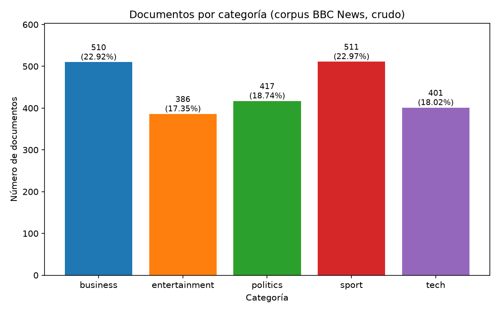
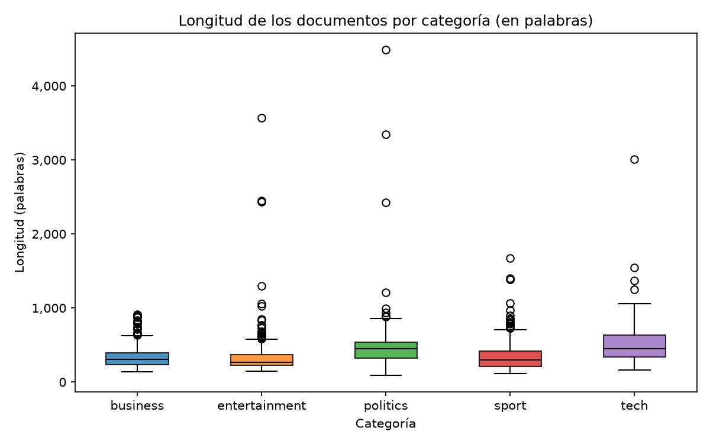

# EDA del corpus crudo (modo raw)

## Resumen

- Entrada: `data/raw/bbc-text.csv` con 2,225 documentos y columnas `category`, `text`.
- Categorías: 5 (business, entertainment, politics, sport, tech).
- Nulos: 0; textos vacíos: 0.
- Duplicados exactos en `text`: 99 filas sobrantes (4.45%); quedarían 2,126 documentos.
- Longitud media: 390.30 palabras (mediana 337.00).
- Documentos con dígitos: 95.10%; con algún símbolo (`£ $ % -`): 96.58%.

## Categorías

| Categoría | Documentos | Porcentaje |
|---|---:|---:|
| business | 510 | 22.92% |
| entertainment | 386 | 17.35% |
| politics | 417 | 18.74% |
| sport | 511 | 22.97% |
| tech | 401 | 18.02% |
| **total** | 2,225 | 100.00% |

## Calidad (nulos y duplicados)

Nulos por columna:

| Columna | Nulos |
|---|---:|
| category | 0 |
| text | 0 |

Duplicados exactos en `text` (se cuentan las copias sobrantes, conservando la primera aparición): **99**, repartidos en 99 grupos de texto repetido (198 filas involucradas). Grupos con categorías contradictorias: 0.

| Categoría | Duplicados sobrantes | % de la categoría | Documentos tras deduplicar |
|---|---:|---:|---:|
| business | 7 | 1.37% | 503 |
| entertainment | 17 | 4.40% | 369 |
| politics | 14 | 3.36% | 403 |
| sport | 7 | 1.37% | 504 |
| tech | 54 | 13.47% | 347 |
| **total** | 99 | 4.45% | 2,126 |

## Longitudes

### En palabras (`text.str.split().str.len()`)

| Grupo | Media | Mediana | Mín | Máx | P25 | P75 |
|---|---:|---:|---:|---:|---:|---:|
| global | 390.30 | 337.00 | 90 | 4,492 | 250.00 | 479.00 |
| business | 334.19 | 303.00 | 142 | 912 | 236.00 | 395.75 |
| entertainment | 337.68 | 267.00 | 144 | 3,570 | 228.25 | 367.75 |
| politics | 461.19 | 449.00 | 90 | 4,492 | 320.00 | 536.00 |
| sport | 336.32 | 296.00 | 116 | 1,671 | 208.00 | 415.50 |
| tech | 507.36 | 450.00 | 165 | 3,007 | 340.00 | 633.00 |

### En caracteres

| Grupo | Media | Mediana | Mín | Máx | P25 | P75 |
|---|---:|---:|---:|---:|---:|---:|
| global | 2,262.94 | 1,965.00 | 501 | 25,483 | 1,446.00 | 2,802.00 |
| business | 1,984.62 | 1,817.50 | 846 | 5,406 | 1,410.25 | 2,371.75 |
| entertainment | 1,926.46 | 1,557.00 | 823 | 19,136 | 1,312.75 | 2,101.00 |
| politics | 2,681.82 | 2,626.00 | 501 | 25,483 | 1,877.00 | 3,146.00 |
| sport | 1,894.88 | 1,640.00 | 719 | 9,471 | 1,189.00 | 2,339.00 |
| tech | 2,974.22 | 2,636.00 | 973 | 16,158 | 2,045.00 | 3,749.00 |

### Caracteres no alfabéticos

- Documentos con al menos un dígito: 95.10% (business 99.02%, entertainment 97.41%, politics 91.13%, sport 93.93%, tech 93.52%).
- Documentos con `£`: 29.08%.
- Documentos con `$`: 21.48%.
- Documentos con `%`: 28.31%.
- Documentos con `-`: 94.56%.
- Documentos con al menos uno de `£ $ % -`: 96.58%.
- Documentos con mayúsculas: 0.00%.
- Otros caracteres no alfanuméricos más frecuentes (carácter: apariciones): `.` 43,717, `-` 12,943, `)` 2,229, `(` 2,227, `%` 1,968, `:` 1,695, `£` 1,403, `$` 1,240, `;` 478, `&` 236, `/` 227, `!` 198, `[` 110, `]` 110, `#` 30.
- Caracteres no ASCII: `£` 1,403.

## Hallazgos que afectan la limpieza

- Quitar los 99 duplicados exactos en `text` (conservar la primera aparición); el corpus pasa a 2,126 documentos.
- Ningún grupo duplicado tiene categorías contradictorias, así que deduplicar no introduce ambigüedad de etiqueta.
- Nulos/vacíos: 0; no hace falta imputar ni descartar.
- 95.10% de los documentos contienen dígitos: decidir si se conservan los números (cifras, años) o se eliminan; si se eliminan, se pierde información como años o importes.
- Símbolos `£ $ % -` presentes en 96.58% de los documentos: si se eliminan puntuación y símbolos, `-` une palabras compuestas (p. ej. `high-definition`) y `£ $ %` acompañan cifras.
- El texto ya viene en minúsculas, sin comas ni comillas (aparentemente sustituidas por dobles espacios) y conserva el punto final de oración; conviene normalizar espacios múltiples y separar puntuación pegada a palabras antes de tokenizar.
- Las longitudes son muy heterogéneas (mín 90, máx 4,492 palabras): considerar el efecto en la normalización por longitud al indexar (p. ej. TF-IDF, BM25).
- Las categorías están desbalanceadas moderadamente; tenerlo en cuenta al evaluar la recuperación por categoría.
